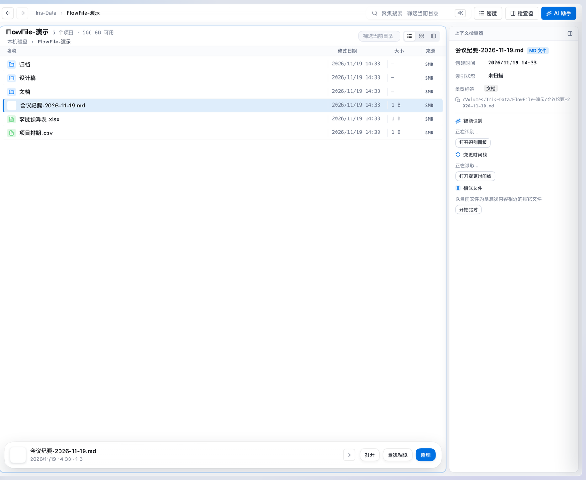

# FlowFile

把「文件管理」做成 DeepSeek Harness 的一项能力：在左侧工作台点开 **FlowFile**，主区域打开一块全幅文件工作台，本机磁盘与已经挂载的 SMB 卷都在同一处浏览，并且可以直接用自然语言下指令。

> **测试版（1.0.0-beta.1）**：功能完整可日常使用，但仍在预发布阶段，接口与数据格式可能变动。遇到问题请到 [Issues](https://github.com/waltxao/DSH-FlowFile/issues) 反馈。

> 方向是「把文件管理装进 AI」，不是「往文件管理器里塞一个 AI 输入框」。所以它长在对话旁边，而不是另一个独立 App。



> 截图为演示数据（`/Volumes/Iris-Data/FlowFile-演示`），并从整屏裁掉了宿主侧栏与文件树。
> 提交截图前请确认画面里没有用户名、工作区名、会话标题、本地账号文件名与含用户名的绝对路径。

## 安装

需要 **DeepSeek Harness 桌面版**。插件声明的兼容范围是 `engines.dsh: >=0.2.1-rc.5 <0.3.0`，超出范围宿主会拒绝加载。

先把 CLI 路径记成变量，后面命令都用它：

```bash
DSH="/Applications/DeepSeek Harness.app/Contents/Resources/runtime/cli/bin/dsh"
```

### 方式一：直接从 Release 装（推荐，不用先下载）

```bash
"$DSH" plugin --profile desktop add \
  https://github.com/waltxao/DSH-FlowFile/releases/download/v1.0.0-beta.1/dsh-flowfile-1.0.0-beta.1.tgz
```

### 方式二：先下载再装

```bash
curl -LO https://github.com/waltxao/DSH-FlowFile/releases/download/v1.0.0-beta.1/dsh-flowfile-1.0.0-beta.1.tgz
"$DSH" plugin --profile desktop add ~/Downloads/dsh-flowfile-1.0.0-beta.1.tgz
```

包文件装完就可以删掉，插件已解到 profile 里，不依赖这个 tgz 继续存在。

### 方式三：从源码目录装（开发用）

```bash
git clone https://github.com/waltxao/DSH-FlowFile.git
"$DSH" plugin --profile desktop add "$PWD/DSH-FlowFile"
```

这条走 `link:` 软链，改代码即生效，适合自己改。

### 卸载

```bash
"$DSH" plugin --profile desktop remove dsh-flowfile
```

### 装完怎么用

左侧工作台列表点 **FlowFile**，主区域打开全幅文件工作台。

### 一个必须避开的坑

**不要用 `pnpm add` 直接往 profile 目录里装。** 这样包会进 `node_modules`，`dsh plugin list` 也列得出来，但 profile 的 `dsh.profile.bundles` 里没有登记它——宿主不会加载，等于装了个死包，而且不会报错，看起来像是插件坏了。

必须走 `dsh plugin add`：它会在 pnpm 装完后把包登记成 profile 的一个 layer。

### 版本与更新

当前通过 GitHub Release 资产分发，尚未发布到 npm registry（`pnpm add dsh-flowfile` 取不到）。更换版本时先 `remove` 再 `add` 新版本，宿主才能重新加载新的模块代际。

预发布版按 `1.0.0-beta.N` 递增。测试版之间也可能改动数据格式（`~/.flowfile/index.db`），升级前建议备份该目录。

## 功能

### 文件管理
浏览本机用户目录、系统盘（Applications / Library / opt / usr）与 macOS 已挂载的 SMB 卷。支持面包屑导航、可输入地址栏、前进后退、列表 / 网格 / 分栏三种视图、列排序、多选、右键菜单、QuickLook 预览、标签读写、在 Finder 中显示。

所有写操作都不自动执行，走同一条执行链：**AI 出计划 → 逐项勾选 → 预检 → 二次确认 → 串行执行 → 可撤销**。移动与重命名使用 `fs.rename`；删除一律进系统回收站并写下恢复清单，可逐字节校验恢复。

### 文件查重
三级判据：大小分桶 → 头尾各 4 KB 的 SHA-256 部分哈希 → 全文件 SHA-256。结果按组展示，给出「保留建议」，不自动删除任何一项。

### 相似文件
图片用 dHash（9×8 灰度，汉明距离阈值 6），文本用 SimHash（阈值 8），再叠加文件名归一化、类型与大小的弱信号。弱信号会标出来，且不允许批量操作。

### 变更时间线
扫描差异与执行链上的写操作都会记进事件表，可按文件或按目录回看。数据落在本地 SQLite，重启后仍在。

### 智能识别
本地采集可观测信号（下载来源、Spotlight 元数据、图片尺寸、Finder 标签、文本首段），交给宿主默认模型生成「这是什么 / 从哪来 / 怎么用 / 能否清理」，每条结论带置信度与证据。证据不足时只列已知信号，「来源未知」是明确的一等状态，不会编一个网址出来。信号在本机采集，只把摘要文本交给模型，不上传文件内容。

### 清理
按规则枚举用户目录内的已索引文件与旧安装包，分「大文件 / 久未使用 / 重复副本 / 旧安装包」四类。候选项与生成的计划默认全不勾选，删除同样走执行链。明确排除网络卷、凭据目录、模型权重、锁文件与隐藏目录。

### 工作台内对话
底部抽屉可以直接对「当前目录 + 选中文件」说话。回复可以是文本、识别卡片或整理计划卡片，计划卡片可逐项勾选后进入执行链。消息落本地 SQLite，刷新后还在。

## 开发

```bash
npm run build    # 拼装 dist/client.js（无打包器，纯脚本拼接）
npm test         # node --test test/*.test.js
```

改了 `src/client-*.js` 之后必须重新 `npm run build`，否则界面跑的还是旧 bundle；改了 host 侧文件需要 `remove` + `add` 触发一次 profile recomposition 才会重新 import。

客户端是一组纯脚本模块，由 `scripts/build.mjs` 拼进 `window.__ModuleLoader__.load` 包装，React 由宿主模块表提供，不引入构建工具链。

## 架构

| 层 | 位置 | 职责 |
| --- | --- | --- |
| 界面 | `src/client-*.js` | 工作台 UI、视图状态、快捷键、抽屉 |
| 路由 | `src/host.js` | `/flowfile/*` 前缀路由，鉴权与参数校验 |
| 能力 | `src/{ops,clean,dedup,similar,recognize,timeline,tags,meta}.js` | 扫描、哈希、识别、计划生成 |
| 存储 | `src/db.js` | 本地 SQLite（`~/.flowfile/index.db`，WAL） |
| 边界 | `src/path-guard.js` | 路径白名单与软链展开 |

数据全部落在 `~/.flowfile/`：`index.db` 存索引、事件、标签与批次；`RESTORE-MANIFEST-<batchId>.json` 存删除恢复清单；`thumbs/` 存缩略图缓存。不写 DSH 工作区，不修改 app.asar。

## 路径边界

默认允许 `~/`、`/Volumes` 下真实挂载的卷，以及系统盘上的 `/Applications`、`/Library`、`/opt`、`/usr`。词法路径与 realpath 展开后的路径都必须在允许范围内，以此挡住 `/Volumes/Iris -> /` 这类软链逃逸。`.ssh`、`.gnupg`、`.aws`、`.kube`、`Keychains` 与私钥类文件一律拒绝。不实现 SMB 协议、不挂载新共享，只读系统已经挂载的 `/Volumes/<share>`。

## 许可

MIT
